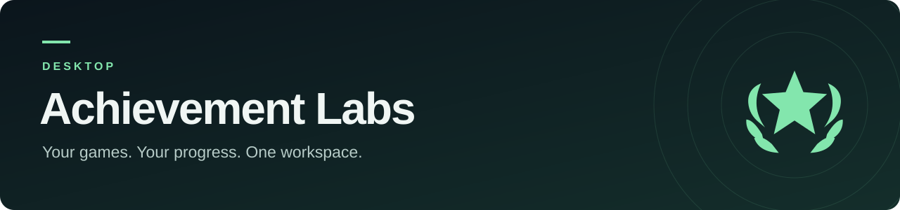
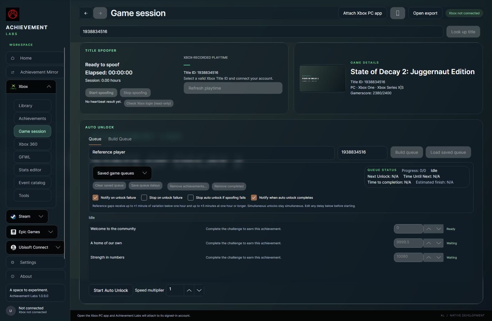
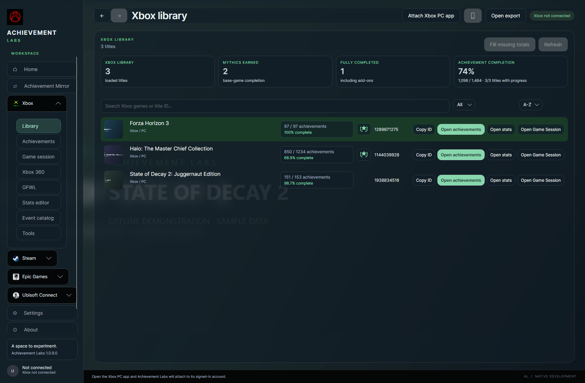
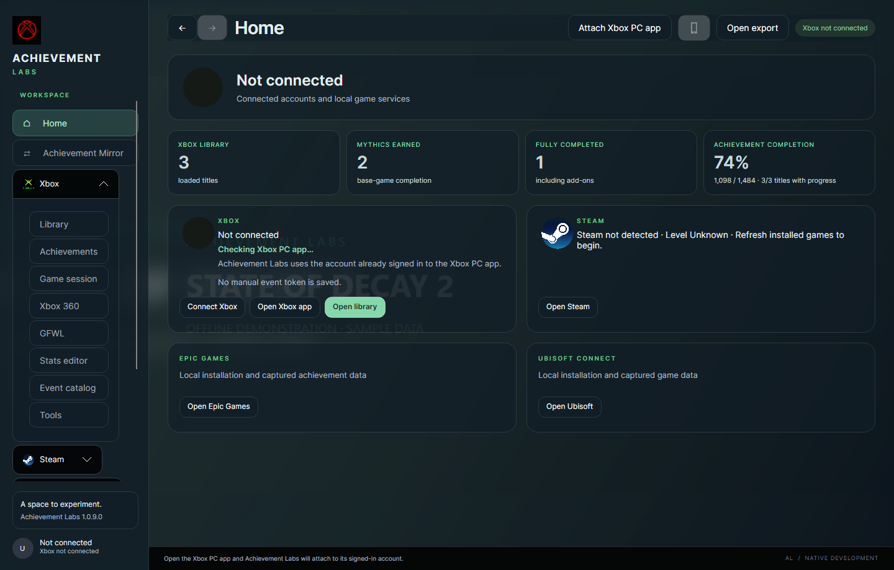

<p align="center">
  
</p>

<h1 align="center">Achievement Labs Desktop</h1>

<p align="center">Free, open-source Xbox achievement unlocker and Steam Achievement Manager tools, with stats, presence, and save editing.</p>

<p align="center">
  <a href="https://github.com/Achievement-Labs/achievement-labs/releases/latest"></a>
  <a href="https://github.com/Achievement-Labs/achievement-labs/releases"></a>
  <a href="https://discord.gg/EY6AJpNfVu"></a>
</p>

<p align="center">
  <a href="https://github.com/Achievement-Labs/achievement-labs/releases/latest"></a>
</p>

Bring your game library, achievement progress, Game Session queues, and profile tools into one desktop workspace. Windows includes workflows for Xbox, Xbox 360, Games for Windows Live, Steam, Epic, and Ubisoft. Separate Mac and Linux previews are also in development.



*Current-source offline preview with sample data. Released builds may differ.*

## Explore the workspace

| Feature | What you can do |
| --- | --- |
| **Library and achievements** | Search your Xbox games, inspect achievement progress, and open a game's tools from its library row. |
| **Game Session** | Keep title-presence controls and Auto Unlock queues together, with editable timing, saved queues, and explicit start/stop controls. |
| **Achievement Mirror** | Review achievement matches between games before choosing the actions to apply. |
| **Stats and event catalog** | Work with title-specific stats and browse event support states, including titles still in testing. |
| **Xbox 360 and legacy tools** | Work with exported profiles and the available legacy workflows. Keep the backups created by the app. |
| **PC game services** | Access Windows workflows for Steam, Epic, Ubisoft, and Games for Windows Live. Availability varies by service. |
| **Appearance** | Adjust glass panels, backgrounds, and OLED mode to suit your setup. |

<table>
  <tr>
    <td width="50%"></td>
    <td width="50%"></td>
  </tr>
  <tr><td><b>Your library at a glance.</b> Progress, completion, and game tools.</td><td><b>A home for your game services.</b> Xbox and PC workflows in one place.</td></tr>
</table>

## Get started

| Platform | Availability | Start here |
| --- | --- | --- |
| **Windows** | Published desktop release | [Download the latest release](https://github.com/Achievement-Labs/achievement-labs/releases/latest) |
| **macOS** | Apple Silicon preview; macOS 14+ | [Mac preview and setup](docs/macos-preview.md) |
| **Linux** | Ubuntu 24.04 x64 preview | [Linux preview and setup](docs/linux-preview.md) |

For Windows, download `AchievementLabs.exe` from the official release page. Read the release notes for that build and keep any additional assets together as instructed. Platform previews have different requirements and feature coverage.

Editing achievement and stat data can carry account risk on a live service. Use test accounts and keep backups. Event support varies by title; review the support states below before using a mapping.

## Join the community

- **Talk and share feedback:** [Achievement Labs Discord](https://discord.gg/EY6AJpNfVu).
- **Report a bug or request a feature:** [open an issue](https://github.com/Achievement-Labs/achievement-labs/issues). Include your app version, platform, and steps to reproduce; remove account credentials and private exports.
- **Contribute:** read [CONTRIBUTING.md](CONTRIBUTING.md), then open a focused pull request.
- **Follow development:** star the repository or use **Watch → Custom → Releases** for release notifications.

<details>
<summary><strong>Developer guide, repository layout, and event support states</strong></summary>

## Build from source

Mac and Linux previews use separate platform builds from this desktop repository.
The Windows build below keeps its existing defaults. See [Linux preview](docs/linux-preview.md)
and [Mac preview](docs/macos-preview.md) for their independent packages and platform requirements.

Install the .NET 9 SDK, then run:

```powershell
dotnet restore .\AchievementLabs.sln
dotnet build .\src\AchievementLabs.Desktop\AchievementLabs.Desktop.csproj -c Release
```

Create the self-contained single-file release candidate with:

```powershell
pwsh -File .\tools\Build-Release.ps1 -Version 1.0.9
```

The release script builds the Avalonia desktop application, the x86 GFWL helper,
and the Steam idle helper. Its output stays under `releases/` and is not committed.

## Repository layout

- `src/AchievementLabs.Desktop/` — native Avalonia desktop client.
- `src/AchievementLabs.Core/` — shared Xbox, Steam, legacy, and catalog logic.
- `src/AchievementLabs.App/` — shared models, services, event templates, and stat catalogs used by the Avalonia client and hosted event service.
- `src/AchievementLabs.App/Events/` — current event catalog, `Data.json`, and one standalone template per title.
- `src/AchievementLabs.App/StatsCatalog/` — title and event stat classifications.
- `server/licensing/` — self-hosted event catalog and account service.
- `site/assets/games.json` — generated public game catalog embedded in the desktop client.
- `tools/` — release and catalog build tools required by the current application.
- `SteamAchievementManager-7.0.41/` — vendored upstream dependency with its license retained.

## Event support states

- **Supported**: mappings have been tested and are expected to work.
- **Testing**: the title has a usable template and mappings, but achievement IDs may
  not match and individual unlock requests may fail. Verify results one at a time.
- **Partially Supported**: some mappings have been tested and are expected to work;
  the rest are still being tested. Verify results one at a time.
- **Coming Soon**: no usable testing template is currently available.

In `Data.json` a title block is Supported when `FullySupported` is `true`, Partially
Supported when `FullySupported` is `false` and the optional `PartiallySupported` is `true`,
Testing otherwise, and Coming Soon when `Enabled` is `false`. Builds that predate
`PartiallySupported` ignore it and show those titles as Testing.

`SupportedTitleIDs` must remain the final top-level property in every `Data.json`.
Each event title must use its own `Events/<titleId>.json` template.

## Local and private data

Authentication files, event tokens, service credentials, databases, research,
packet captures, build output, save backups, and machine-specific agent settings
are excluded through `.gitignore`.


</details>

## Credits

Achievement Labs builds on ideas and prior work from the original Xbox Achievement Unlocker project and includes Steam Achievement Manager code under its retained upstream license. See the source and bundled notices for attribution.
